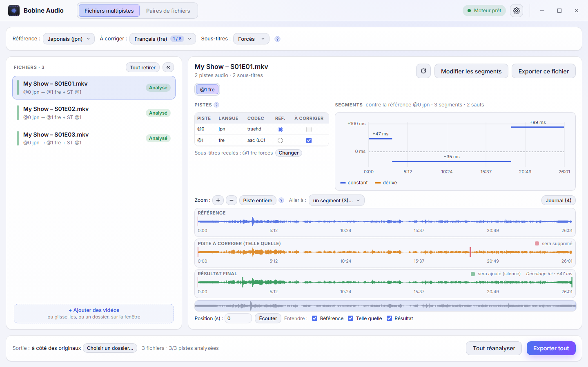
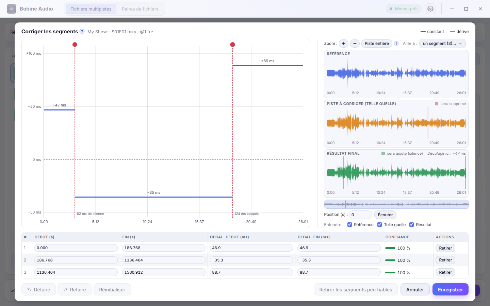
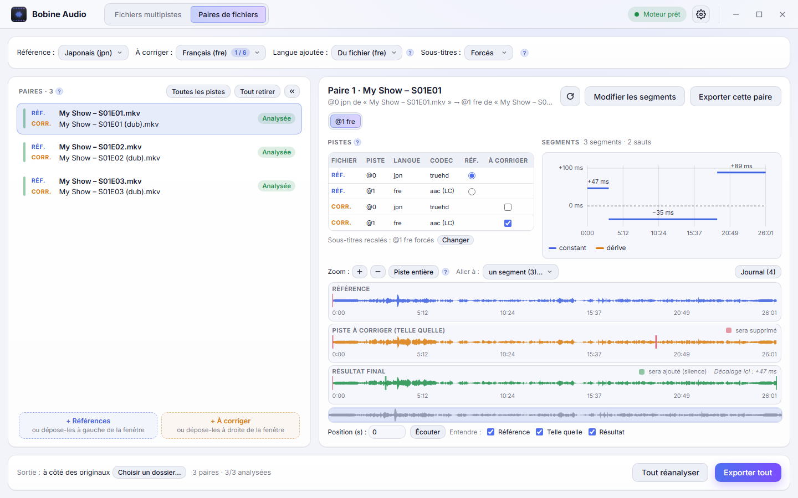

<a href="guide.md">English</a> | Français

# Guide d'utilisation

Ce guide explique comment utiliser Bobine Audio, de l'ajout des fichiers à l'export, pour un épisode comme pour une saison entière. Pour l'installation, voir le [README](../README.fr.md#installation).

## Sommaire

1. [Les mots à connaître](#les-mots-à-connaître)
2. [La fenêtre](#la-fenêtre)
3. [Fichiers multipistes, pas à pas](#fichiers-multipistes-pas-à-pas)
4. [Lire le résultat](#lire-le-résultat)
5. [Corriger les segments à la main](#corriger-les-segments-à-la-main)
6. [Exporter](#exporter)
7. [Les sous-titres](#les-sous-titres)
8. [Paires de fichiers](#paires-de-fichiers)
9. [Paramètres](#paramètres)
10. [Questions fréquentes](#questions-fréquentes)

## Les mots à connaître

- **Référence** : la piste audio calée sur la vidéo, en général la version originale. Elle n'est jamais modifiée : c'est elle qui sert de repère.
- **Piste à corriger** : la piste décalée, en général un doublage. C'est elle que Bobine Audio recale sur la référence.
- **Décalage** : l'écart entre les deux pistes à un instant donné, en millisecondes. **+** veut dire que la piste à corriger est **en retard** sur la référence, **−** qu'elle est **en avance**.
- **Segment** : un morceau du fichier sur lequel le décalage suit une même règle. Un fichier décalé de la même façon du début à la fin n'a qu'un segment ; un fichier monté différemment en a plusieurs.
- **Constant, dérive, saut** :
  - *constant* : le décalage reste le même sur tout le segment ;
  - *dérive* : il change peu à peu (typiquement une cadence d'images différente) ;
  - *saut* : il change d'un coup entre deux segments (une scène plus longue ou plus courte dans une version, une coupure pub).
- **Confiance** : à quel point la détection d'un segment est sûre, de 0 à 100 %. En dessous de 40 %, le segment est signalé **⚠ peu fiable**.

## La fenêtre

La barre du haut choisit l'un des deux **modes**, selon l'organisation de tes fichiers :

| Tes fichiers… | Mode |
| --- | --- |
| Chaque épisode est un seul fichier qui contient déjà la VO et la VF (un MKV avec les deux, par exemple) | **Fichiers multipistes** |
| La VO et la VF sont dans des fichiers séparés (par exemple `S01E01.mkv` et `S01E01.VF.ac3`) | **Paires de fichiers** |

Un seul fichier marche aussi bien qu'une saison entière : les deux modes en prennent un ou plusieurs. Chaque mode garde ses fichiers quand tu passes à l'autre ; le dernier mode utilisé est repris au lancement suivant.

À droite de la barre : l'**état du moteur** (« Moteur prêt » une fois le moteur d'analyse démarré), l'icône de **mise à jour** quand une nouvelle version est sortie, et **⚙ Paramètres**.

En dessous, l'espace de travail :

- en haut, la **barre de réglages** : les pistes à utiliser, pour tous les fichiers à la fois ;
- à gauche, la **liste** des fichiers. Clique sur un fichier pour l'afficher ; **↑ / ↓** passent au précédent ou au suivant. Au survol d'une ligne, ↑ ↓ la déplacent et ✕ la retire ; **Tout retirer** vide la liste (après confirmation, si des analyses ou des modifications seraient perdues). Le bouton **«** replie la liste en une colonne étroite, pour gagner de la place sur un petit écran ;
- à droite, le **détail** du fichier choisi ;
- en bas, le dossier de **sortie**, l'avancement, et les boutons pour tous les fichiers à la fois.

Un seul bouton est mis en avant (en couleur) : l'étape suivante, « Analyser tout » puis « Exporter tout » (ou, avec un seul fichier, « Analyser » puis « Exporter ce fichier »).

## Fichiers multipistes, pas à pas

<picture>
  <source media="(prefers-color-scheme: dark)" srcset="screenshots/main-fr-dark.png">
  
</picture>

1. **Ajoute les fichiers** : dépose-les sur la fenêtre, ou clique sur la zone vide. Déposer un **dossier** ajoute ses fichiers vidéo et audio dans l'ordre des noms (« Épisode 2 » avant « Épisode 10 »).
2. **Choisis les pistes** dans la barre de réglages, pour tous les fichiers à la fois :
   - **Référence** : par **numéro de piste**, **langue** ou **nom de piste**. La langue est le plus sûr sur une saison : un numéro de piste peut changer d'un épisode à l'autre ;
   - **À corriger** : une ou plusieurs pistes, choisies de la même façon.

   Au premier fichier ajouté, Bobine Audio propose sa première piste comme référence et les autres langues à corriger.
3. **Vérifie la liste** : sous chaque nom, `@0 jpn → @1 fre + ST @1` résume ce qui sera fait (« piste 1 recalée sur la piste 0, avec la piste de sous-titres 1 »). Un fichier où il manque une piste à corriger est signalé **⚠ À vérifier** ; un fichier où la référence ne désigne pas une seule piste affiche « (auto) ». Dans le détail, le **tableau des pistes** fixe les pistes d'un fichier à la main (colonnes **Réf.** et **À corriger**) ; « Par langue » revient au choix de la barre.
4. **Analyse** : « Analyser tout » analyse tous les fichiers, l'un après l'autre. Ensuite, le bouton n'analyse que ce qui manque (nouveaux fichiers, échecs) sans perdre tes corrections ; « Tout réanalyser » recommence tout. Dans le détail d'un fichier, **⟳** réanalyse ce fichier seul.
5. **Vérifie le résultat** de chaque fichier (voir [Lire le résultat](#lire-le-résultat)), et corrige-le à la main si besoin (« Modifier les segments »).
6. **Exporte** : « Exporter tout », ou « Exporter ce fichier » dans un détail (voir [Exporter](#exporter)).

## Lire le résultat

Le détail d'un fichier montre, sous son nom, un bouton par **piste corrigée** (`@1 fre`) : s'il y en a plusieurs, il choisit celle affichée. « Journal » montre les messages de l'analyse.

Dans une grande fenêtre, le graphe et les formes d'onde s'affichent l'un sous l'autre ; dans une plus petite, les onglets **Segments** et **Écoute** passent de l'un à l'autre.

### Le graphe des décalages

À côté du tableau des pistes, le graphe montre le décalage (verticalement) tout au long du fichier (horizontalement). La ligne pointillée « 0 ms » correspond à la référence. Au-dessus, un résumé : « 3 segments · 2 sauts ».

- Chaque segment est un trait : **bleu** s'il est constant, **orange** s'il dérive.
- Un trait **en pointillés** est peu fiable : à vérifier à l'écoute.
- Un changement de hauteur entre deux traits est un **saut**.

### Les formes d'onde

Trois formes d'onde, sur la même échelle de temps :

- **Référence** : la piste qui ne bouge pas.
- **Piste à corriger (telle quelle)** : avant correction. Les zones **rouges** seront **supprimées** : du contenu en trop dans cette version (par exemple une scène plus longue).
- **Résultat final** : ce que contiendra l'export. Les zones **vertes** sont du **silence ajouté** : du contenu qui manque dans cette version. « Décalage ici » indique la correction appliquée à la position.

Pour se déplacer :

- la **molette** zoome ou dézoome sous le curseur ; **+** / **−** et « Piste entière » font de même avec des boutons ; « Aller à » place la vue sur un segment ;
- un **clic** place la position (le trait rouge) à cet endroit ; **glisser** la déplace avec la souris ;
- **glisser avec le clic molette**, ou la barre sous les formes d'onde, déplace la vue dans la piste.

### L'écoute

« Écouter » (ou la **barre d'espace**) joue à partir de la « Position » ; une seconde fois, ça s'arrête. Les cases **Entendre** choisissent ce qu'on entend : la référence, la piste telle quelle et le résultat final, dans n'importe quelle combinaison.

Le plus parlant est d'écouter la **référence avec le résultat final** : si la correction est juste, les deux sonnent comme une seule piste, sans écho. Avec la piste telle quelle, on entend au contraire le décalage d'origine.

## Corriger les segments à la main

La détection se base sur le son commun aux deux versions (musique, bruitages). Là où il n'y en a pas, elle peut se tromper. « Modifier les segments » ouvre l'éditeur pour corriger ça.

<picture>
  <source media="(prefers-color-scheme: dark)" srcset="screenshots/editor-fr-dark.png">
  
</picture>

Dans le graphe :

- **Glisse un segment** vers le haut ou le bas pour changer son décalage.
- **Glisse une poignée ●** pour déplacer la frontière entre deux segments.
- **Double-clique** pour couper un segment en deux à cet endroit.
- **Clique** pour placer la position à cet endroit, ou glisse pour la déplacer ; **glisse avec le clic molette** pour te déplacer dans la piste.
- La **molette** zoome, en même temps que les formes d'onde.

Dans le tableau, chaque valeur peut aussi être tapée au clavier : début et fin en secondes, décalage au début et à la fin en millisecondes. Un décalage de début différent de celui de fin fait une dérive.

- **Retirer** supprime un segment, typiquement une fausse détection : son voisin s'étend sur sa durée, avec son propre décalage. Au survol, le résultat est prévisualisé en pointillés verts sur le graphe.
- **Retirer les segments peu fiables** fait la même chose pour tous les segments ⚠ d'un coup.
- **Défaire / Refaire** (Ctrl+Z / Ctrl+Y) et **Réinitialiser** (retour à l'état d'ouverture de l'éditeur).
- **Enregistrer** garde les modifications ; **Annuler** (ou Échap) les abandonne, après confirmation s'il y en a.

Les formes d'onde et l'écoute suivent tes modifications en direct : c'est le moyen le plus sûr de vérifier une correction.

## Exporter

**Sortie**, en bas à gauche, choisit où écrire les exports :

- **à côté des originaux** (par défaut), avec le suffixe « .synced » : `Film.mkv` donne `Film.synced.mkv` ;
- ou **un autre dossier** (« Choisir un dossier… »), où chaque export garde le nom de son original, sauf si ce nom y est déjà pris.

Ce choix est retenu. Le fichier d'origine n'est jamais modifié.

« Exporter tout » écrit un fichier par épisode, un à la fois ; « Exporter ce fichier » n'écrit que celui affiché. « Annuler l'export » arrête celui en cours et ne lance pas les suivants : aucun fichier à moitié écrit ne reste sur le disque. Une fois un fichier écrit, l'icône de dossier dans son détail ouvre son dossier.

Le fichier exporté est un **MKV** qui contient :

- la **vidéo**, copiée telle quelle (sans réencodage, donc sans perte) ;
- la **piste de référence**, copiée telle quelle ;
- chaque **piste corrigée**, réencodée dans son format d'origine et à son débit d'origine. Deux exceptions : l'AAC devient de l'Opus (l'encodeur AAC disponible est trop lent), et les formats sans équivalent (TrueHD, DTS…) deviennent du FLAC, sans perte ;
- les **sous-titres** (voir [Les sous-titres](#les-sous-titres)).

Les autres pistes audio du fichier ne sont pas incluses.

## Les sous-titres

Un sous-titre calé sur une piste audio doit subir les mêmes corrections qu'elle : sinon, une fois l'audio recalé, il serait décalé à son tour. C'est typiquement le cas des **sous-titres forcés** d'un doublage (panneaux, dialogues en langue étrangère), calés sur la VF et pas sur la vidéo.

- **Sous-titres**, dans la barre de réglages, choisit ceux qui sont recalés avec chaque piste corrigée, pour tous les fichiers : **Forcés** (de la même langue que la piste, par défaut), **Tous** (de la même langue) ou **Aucun**. Le choix par défaut se change dans les [Paramètres](#paramètres).
- Dans le détail d'un fichier, « Sous-titres recalés » montre ceux choisis ; **Changer** coche ou décoche chaque piste de sous-titres de ce fichier.
- Les sous-titres non cochés sont **copiés tels quels**, calés sur la vidéo.
- Une piste de sous-titres ne peut être recalée qu'avec une seule piste audio.
- Seuls les sous-titres **texte** (SRT, ASS) peuvent être recalés. Les sous-titres **image** (PGS, VobSub) sont toujours copiés tels quels.

## Paires de fichiers

<picture>
  <source media="(prefers-color-scheme: dark)" srcset="screenshots/pairs-fr-dark.png">
  
</picture>

Chaque ligne de la liste est une **paire** : en haut le fichier de **référence** (Réf., la vidéo avec sa VO), en dessous le fichier **à corriger** (Corr., une autre vidéo, ou un simple fichier audio : WAV, FLAC, AC3, AAC…). La piste corrigée est ajoutée à la vidéo de référence.

Tout le reste marche comme en [fichiers multipistes](#fichiers-multipistes-pas-à-pas), à ces différences près :

- **Ajouter** : « + Références » et « + À corriger » sous la liste. En déposant des fichiers, la **moitié gauche** de la fenêtre les ajoute aux références et la **moitié droite** aux fichiers à corriger.
- Les fichiers sont appariés **dans l'ordre** : les ↑ ↓ d'une ligne remettent une colonne dans le bon ordre. Un fichier sans son pendant est signalé **⚠ Sans paire**.
- **Pistes** : choisies dans la barre de réglages d'après le premier fichier de chaque colonne, puis appliquées à toutes les paires. « Toutes les pistes », au-dessus de la liste, montre les pistes de chaque fichier, pour s'assurer que tous les épisodes ont la même organisation. Dans le détail d'une paire, le tableau des pistes réunit celles des deux fichiers (colonne Fichier : Réf. ou Corr.) : changer une case fixe les pistes de cette paire seulement, « Par défaut » revient à celles de la barre.
- **Langue ajoutée** : la langue donnée à la piste corrigée dans l'export. « Du fichier » garde la sienne ; utile d'en choisir une pour un fichier audio qui n'en a pas.
- **Sous-titres** : les sous-titres texte du fichier à corriger, dans la langue de sa piste, sont importés et recalés avec elle.
- L'export part du fichier de référence : sa vidéo, sa piste de référence et ses sous-titres, plus la ou les pistes corrigées.

## Paramètres

Le bouton **⚙** en haut à droite ouvre les Paramètres :

- **Thème** : Système (suit le thème clair ou sombre du système), Clair ou Sombre.
- **Langue** : Système (français si le système est en français, anglais sinon), Français ou English.
- **Taille de l'interface** : 90, 100, 110 ou 125 % : textes, boutons et formes d'onde s'agrandissent ou rapetissent ensemble. Sur un écran sans la place pour la taille choisie (un petit portable avec une grande mise à l'échelle de Windows, par exemple), l'interface est réduite pour tenir, et les Paramètres l'indiquent.
- **Sous-titres par défaut** : quels sous-titres sont recalés avec une piste corrigée, sauf choix contraire : le réglage de départ des deux modes.
- **Mises à jour** : vérifier ou non au démarrage si une nouvelle version existe.
- **Cache d'analyse** : Bobine Audio garde les analyses déjà faites, pour qu'un fichier rouvert s'affiche tout de suite. « Vider » libère la place ; les fichiers seront simplement réanalysés.

Quand une mise à jour est disponible, une icône apparaît à côté du ⚙ : « Installer et redémarrer » la télécharge, l'installe et relance l'application. Une analyse ou un export en cours est alors interrompu.

## Questions fréquentes

**Windows affiche « Windows a protégé votre ordinateur » à l'installation.**
L'installateur n'est pas signé par un certificat payant. Clique sur « Informations complémentaires », puis « Exécuter quand même ».

**« Démarrage du moteur… » s'affiche en haut à droite.**
Le moteur d'analyse démarre en arrière-plan, en général en une seconde ou deux. On peut déjà ajouter des fichiers : leurs pistes s'affichent dès qu'il est prêt.

**« Le moteur ne répond pas ».**
Clique sur « Réessayer ». Si ça ne suffit pas, ferme et relance l'application. Si le problème revient, un antivirus bloque peut-être le moteur (sous Windows, `engine\syncaudio-engine.exe` dans le dossier d'installation).

**Un segment est marqué ⚠ peu fiable.**
Les mesures ne s'accordent pas entre elles sur ce passage, ou sont trop peu nombreuses. C'est fréquent sur un passage sans musique ni bruitage (une narration, une voix intérieure) : la détection peut alors se caler sur les dialogues, qui diffèrent justement entre deux langues. Écoute le passage : si le décalage sonne faux, corrige-le dans l'éditeur ou retire le segment.

**Le résultat sonne en écho.**
Le décalage n'est pas bon à cet endroit. Écoute la référence avec le résultat final, repère où l'écho commence, et ajuste les segments dans l'éditeur.

**La fenêtre ne tient pas sur mon écran, ou tout est trop petit / trop grand.**
Change la **Taille de l'interface** dans les Paramètres. Sur un petit écran, Bobine Audio s'ouvre déjà en plein écran et réduit l'interface pour qu'elle tienne.

**Où sont gardées les analyses ? Combien de place prennent-elles ?**
Sous Windows dans `%LOCALAPPDATA%\Bobine Audio\cache`, sous Linux dans `~/.cache/bobine-audio` : 512 Mo au plus, les plus anciennes étant supprimées au-delà. Les Paramètres affichent leur taille et permettent de les vider. Sous Windows, la désinstallation les supprime ; sous Linux, vide-les d'abord depuis les Paramètres.

**Mon fichier d'origine est-il modifié ?**
Non, jamais. L'export écrit toujours un nouveau fichier.

**Mes sous-titres sont décalés après l'export.**
Ils étaient probablement calés sur la piste audio corrigée et pas sur la vidéo : coche-les via « Changer » dans le détail du fichier, puis exporte à nouveau. Les sous-titres image (PGS, VobSub) ne peuvent pas être recalés.
