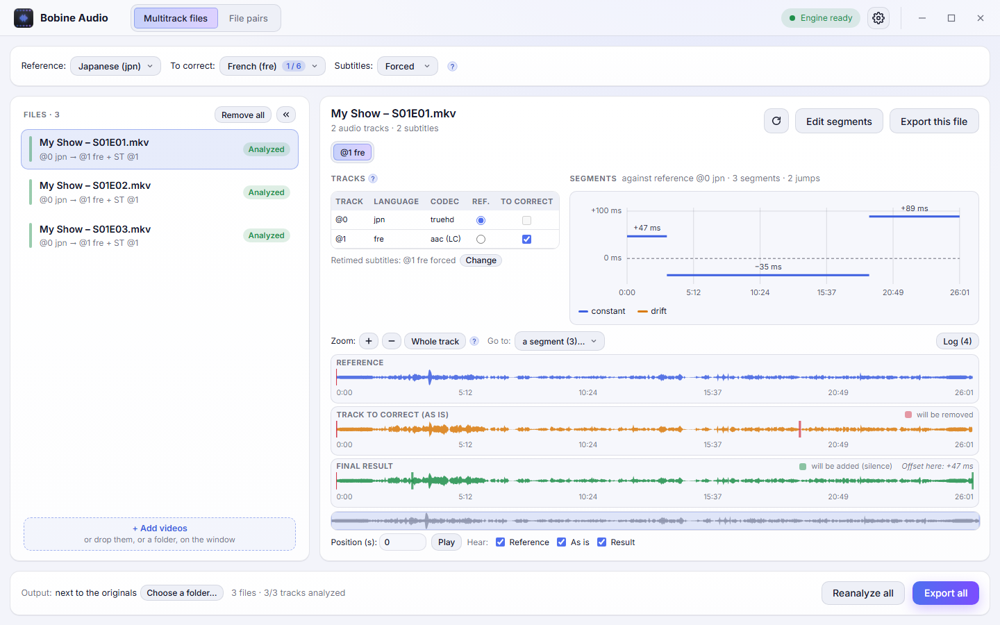
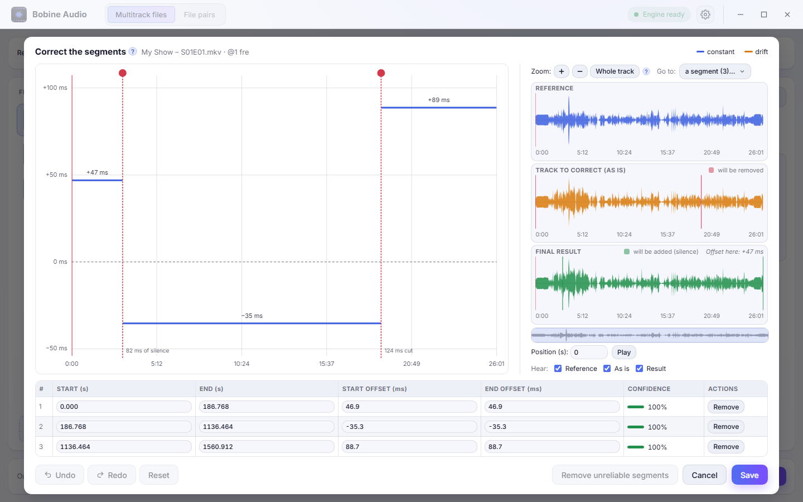
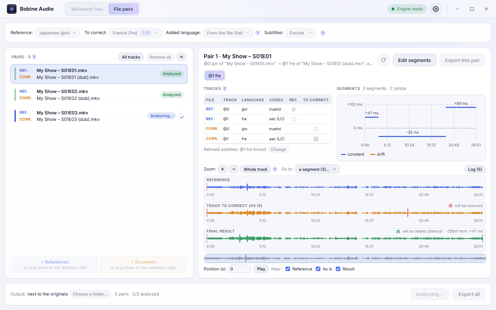

English | <a href="guide.fr.md">Français</a>

# User guide

This guide explains how to use Bobine Audio, from adding your files to exporting them, one episode or a whole season at once. For installing it, see the [README](../README.md#install).

## Contents

1. [Words to know](#words-to-know)
2. [The window](#the-window)
3. [Multitrack files, step by step](#multitrack-files-step-by-step)
4. [Reading the result](#reading-the-result)
5. [Correcting the segments by hand](#correcting-the-segments-by-hand)
6. [Exporting](#exporting)
7. [Subtitles](#subtitles)
8. [File pairs](#file-pairs)
9. [Settings](#settings)
10. [FAQ](#faq)

## Words to know

- **Reference**: the audio track that is in sync with the video, usually the original version. It is never changed: it's the one everything is lined up on.
- **Track to correct**: the out-of-sync track, usually a dub. It's the one Bobine Audio puts back in sync with the reference.
- **Offset**: the gap between the two tracks at a given moment, in milliseconds. **+** means the track to correct is **late** on the reference, **−** that it's **early**.
- **Segment**: a stretch of the file over which the offset follows one rule. A file that is equally off from start to end has one segment; a file cut differently has several.
- **Constant, drift, jump**:
  - *constant*: the offset stays the same over the whole segment;
  - *drift*: it changes little by little (typically a different frame rate);
  - *jump*: it changes all at once between two segments (a scene longer or shorter in one version, an ad break).
- **Confidence**: how sure the detection of a segment is, from 0 to 100%. Below 40%, the segment is flagged **⚠ unreliable**.

## The window

The bar at the top picks one of the two **modes**, depending on how your files are organized:

| Your files… | Mode |
| --- | --- |
| Each episode is one file that already holds the original audio and the dub (an MKV with both, for instance) | **Multitrack files** |
| The original and the dub are in separate files (for instance `S01E01.mkv` and `S01E01.dub.ac3`) | **File pairs** |

One file works as well as a whole season: both modes take one file or many. Each mode keeps its own files when you switch to the other; the mode used last is picked again next time.

On the right of the bar: the **engine's state** ("Engine ready" once the analysis engine has started), the **update** icon when a new version is out, and **⚙ Settings**.

Below, the workspace:

- at the top, the **settings bar**: the tracks to use, for every file at once;
- on the left, the **list** of files. Click one to show it; **↑ / ↓** go to the previous or next one. Hovering a row shows ↑ ↓ to move it and ✕ to remove it; **Remove all** empties the list (after asking, if analyses or edits would be lost). The **«** button folds the list into a narrow column, for more room on a small screen;
- on the right, the **detail** of the file picked;
- at the bottom, the **output** folder, the progress, and the buttons for every file at once.

There is always one highlighted button (in color): the next step, "Analyze all" then "Export all" (or, with one file, "Analyze" then "Export this file").

## Multitrack files, step by step

<picture>
  <source media="(prefers-color-scheme: dark)" srcset="screenshots/main-en-dark.png">
  
</picture>

1. **Add the files**: drop them on the window, or click the empty area. Dropping a **folder** adds its video and audio files in name order ("Episode 2" before "Episode 10").
2. **Pick the tracks** in the settings bar, for every file at once:
   - **Reference**: by **track number**, **language** or **track name**. Language is the most reliable across a season: a track number can change from one episode to the next;
   - **To correct**: one or more tracks, picked the same way.

   When the first file is added, Bobine Audio suggests its first track as the reference and the other languages to correct.
3. **Check the list**: under each name, `@0 jpn → @1 fre + ST @1` sums up what will be done ("track 1 synced to track 0, with subtitle track 1"). A file where a track to correct is missing is flagged **⚠ To check**; a file where the reference doesn't name exactly one track shows "(auto)". In the detail, the **tracks table** sets a file's tracks by hand (**Ref.** and **To correct** columns); "By language" goes back to the bar's pick.
4. **Analyze**: "Analyze all" analyzes every file, one after the other. Afterwards, the button only analyzes what's missing (new files, failures) without losing your corrections; "Reanalyze all" starts over. In a file's detail, **⟳** reanalyzes that file alone.
5. **Check the result** of each file (see [Reading the result](#reading-the-result)), and correct it by hand if needed ("Edit segments").
6. **Export**: "Export all", or "Export this file" in a detail (see [Exporting](#exporting)).

## Reading the result

A file's detail shows, under its name, one button per **corrected track** (`@1 fre`): with several, it picks the one shown. "Log" shows the analysis's messages.

On a large window, the chart and the waveforms are shown one under the other; on a smaller one, the **Segments** and **Listen** tabs switch between them.

### The offset chart

Next to the tracks table, the chart shows the offset (vertically) along the whole file (horizontally). The dashed "0 ms" line is the reference. Above it, a summary: "3 segments · 2 jumps".

- Each segment is a line: **blue** when constant, **orange** when drifting.
- A **dotted** line is unreliable: worth checking by ear.
- A change of height between two lines is a **jump**.

### The waveforms

Three waveforms on the same time scale:

- **Reference**: the track that doesn't move.
- **Track to correct (as is)**: before correction. **Red** areas will be **removed**: content this version has in excess (a longer scene, for instance).
- **Final result**: what the export will hold. **Green** areas are **added silence**: content this version is missing. "Offset here" shows the correction applied at the position.

To move around:

- the **mouse wheel** zooms in or out under the pointer; **+** / **−** and "Whole track" do the same with buttons; "Go to" jumps to a segment;
- a **click** moves the position (the red line) there; **dragging** moves it with the mouse;
- a **middle-click drag**, or the bar under the waveforms, moves along the track.

### Listening

"Play" (or the **space bar**) plays from the "Position"; again, it stops. The **Hear** boxes pick what you hear: the reference, the track as is and the final result, in any combination.

The most telling is to hear the **reference with the final result**: when the correction is right, they sound like a single track, with no echo. With the track as is, you hear the original offset instead.

## Correcting the segments by hand

Detection relies on the sound both versions share (music, sound effects). Where there is none, it can get it wrong. "Edit segments" opens the editor to fix that.

<picture>
  <source media="(prefers-color-scheme: dark)" srcset="screenshots/editor-en-dark.png">
  
</picture>

In the chart:

- **Drag a segment** up or down to change its offset.
- **Drag a ● handle** to move the boundary between two segments.
- **Double-click** to split a segment in two there.
- **Click** to move the position there, or drag to move it; **middle-click and drag** to move along the track.
- The **mouse wheel** zooms, along with the waveforms.

In the table, every value can also be typed in: start and end in seconds, offset at the start and at the end in milliseconds. A start offset different from the end offset makes a drift.

- **Remove** deletes a segment, typically a false detection: its neighbour extends over its duration, with its own offset. On hover, the result is previewed as green dots on the chart.
- **Remove unreliable segments** does the same for every ⚠ segment at once.
- **Undo / Redo** (Ctrl+Z / Ctrl+Y) and **Reset** (back to the state the editor opened with).
- **Save** keeps the changes; **Cancel** (or Esc) discards them, after asking if there are any.

The waveforms and the listening follow your changes live: it's the surest way to check a correction.

## Exporting

**Output**, at the bottom left, picks where the exports go:

- **next to the originals** (the default), with the ".synced" suffix: `Film.mkv` gives `Film.synced.mkv`;
- or **another folder** ("Choose a folder…"), where each export keeps its original's name, unless that name is already taken there.

The choice is remembered. The original file is never changed.

"Export all" writes one file per episode, one at a time; "Export this file" writes only the one shown. "Cancel export" stops the one running and doesn't start the next ones: no half-written file is left on disk. Once a file is written, the folder icon in its detail opens its folder.

The exported file is an **MKV** holding:

- the **video**, copied as is (not re-encoded, so no loss);
- the **reference track**, copied as is;
- each **corrected track**, re-encoded in its original format and bitrate. Two exceptions: AAC becomes Opus (the available AAC encoder is too slow), and formats with no encoder (TrueHD, DTS…) become lossless FLAC;
- the **subtitles** (see [Subtitles](#subtitles)).

The file's other audio tracks are left out.

## Subtitles

Subtitles timed on an audio track must get the same corrections as that track: otherwise, once the audio is back in sync, they would be off in turn. That's typically the case for a dub's **forced subtitles** (signs, lines in a foreign language), timed on the dub rather than on the video.

- **Subtitles**, in the settings bar, picks which ones are retimed with each corrected track, for every file: **Forced** (same language as the track, the default), **All** (same language) or **None**. The default can be changed in [Settings](#settings).
- In a file's detail, "Retimed subtitles" shows the ones picked; **Change** ticks or unticks each subtitle track of that file.
- Unticked subtitles are **copied as they are**, timed on the video.
- A subtitle track can be retimed with one audio track only.
- Only **text** subtitles (SRT, ASS) can be retimed. **Image** subtitles (PGS, VobSub) are always copied as they are.

## File pairs

<picture>
  <source media="(prefers-color-scheme: dark)" srcset="screenshots/pairs-en-dark.png">
  
</picture>

Each row of the list is a **pair**: on top the **reference** file (Ref., the video with its original audio), under it the file **to correct** (Corr., another video, or a bare audio file: WAV, FLAC, AC3, AAC…). The corrected track is added to the reference video.

Everything else works as in [Multitrack files](#multitrack-files-step-by-step), with these differences:

- **Adding**: "+ References" and "+ To correct" under the list. When dropping files, the **left half** of the window adds them to the references and the **right half** to the files to correct.
- Files are paired **in order**: the ↑ ↓ of a row put a column back in the right order. A file without its match is flagged **⚠ Unpaired**.
- **Tracks**: picked in the settings bar from the first file of each column, then applied to every pair. "All tracks", above the list, shows each file's tracks, to make sure every episode is organized the same way. In a pair's detail, the tracks table holds both files' tracks (File column: Ref. or Corr.): changing a box sets that pair's tracks only, "By default" goes back to the bar's.
- **Added language**: the language given to the corrected track in the export. "From the file" keeps its own; picking one helps for an audio file that has none.
- **Subtitles**: the text subtitles of the file to correct, in its track's language, are imported and retimed with it.
- The export starts from the reference file: its video, its reference track and its subtitles, plus the corrected track(s).

## Settings

The **⚙** button at the top right opens Settings:

- **Theme**: System (follows the system's light or dark theme), Light or Dark.
- **Language**: System (French if the system is in French, English otherwise), Français or English.
- **Interface size**: 90, 100, 110 or 125%: text, buttons and waveforms all get bigger or smaller. On a screen without room for the size chosen (a small laptop with a large Windows scaling, for instance), the interface is reduced to fit, and Settings say so.
- **Default subtitles**: which subtitles are retimed with a corrected track unless picked otherwise: the starting setting of both modes.
- **Updates**: whether to check for a new version at startup.
- **Analysis cache**: Bobine Audio keeps the analyses already made, so a reopened file shows up at once. "Clear" frees the space; files are just analyzed again.

When an update is available, an icon shows next to the ⚙: "Install and restart" downloads it, installs it and restarts the app. An analysis or export in progress is interrupted then.

## FAQ

**Windows says "Windows protected your PC" when installing.**
The installer isn't signed with a paid certificate. Click "More info", then "Run anyway".

**"Starting the engine…" shows at the top right.**
The analysis engine is starting in the background, usually in a second or two. Files can already be added: their tracks show up as soon as it's ready.

**"The engine isn't responding".**
Click "Retry". If that's not enough, close and restart the app. If it keeps happening, an antivirus may be blocking the engine (on Windows, `engine\syncaudio-engine.exe` in the install folder).

**A segment is flagged ⚠ unreliable.**
The measurements disagree with each other over that stretch, or there are too few of them. It's common over a stretch with no music or sound effects (a narration, an inner voice): detection can then latch onto the dialogue, which is exactly what differs between two languages. Listen to it: if the offset sounds wrong, fix it in the editor or remove the segment.

**The result sounds like an echo.**
The offset is wrong there. Listen to the reference with the final result, find where the echo starts, and adjust the segments in the editor.

**The window doesn't fit my screen, or everything is too small / too big.**
Change **Interface size** in Settings. On a small screen, Bobine Audio already opens maximized and reduces the interface to fit.

**Where are the analyses kept? How much space do they take?**
On Windows in `%LOCALAPPDATA%\Bobine Audio\cache`, on Linux in `~/.cache/bobine-audio`: 512 MB at most, the oldest ones being deleted beyond that. Settings show their size and can clear them. Uninstalling removes them on Windows; on Linux, clear them from Settings first.

**Is my original file changed?**
No, never. Exporting always writes a new file.

**My subtitles are off after exporting.**
They were probably timed on the corrected audio track rather than on the video: tick them through "Change" in the file's detail, then export again. Image subtitles (PGS, VobSub) can't be retimed.
